# Pipeline de inferencia end-to-end: del papel a LeNet

**Autor:** John Fredy Montenegro — Estudiante MIAA Icesi

Proyecto que conecta las técnicas clásicas de procesamiento digital de imágenes con
una arquitectura fundacional de aprendizaje profundo (LeNet-5). El pipeline toma una
fotografía de caracteres escritos a mano, aísla cada uno, lo estandariza al dominio del
dataset MNIST y lo clasifica con un modelo pre-entrenado. Como bonificación, el mismo
pipeline se extiende a letras (EMNIST), a fotos de bajo contraste y a trazos conectados.

## Contenido

- `pipeline_mnist_lenet.ipynb`: notebook de Google Colab con el pipeline completo,
  documentado etapa por etapa con imágenes intermedias y conclusiones técnicas.
- `imagenes/`: figuras generadas por el notebook en la ejecución reportada en este
  documento.

## Resumen de resultados

| Métrica | Resultado |
|---------|-----------|
| Exactitud LeNet-5 en prueba MNIST (10 000 imágenes) | **98.96 %** |
| Exactitud de validación MNIST (última época) | 99.45 % |
| Exactitud LeNet-5 en prueba EMNIST `balanced` (18 800 imágenes, 47 clases) | **85.69 %** |
| Exactitud de validación EMNIST (última época) | 85.69 % |
| Caracteres detectados en la foto de prueba | 4 de 4, sin falsos positivos |
| Lectura de la foto `L0V3` con el modelo de dígitos (MNIST) | `1043` |
| Lectura con el modelo alfanumérico (EMNIST) | `L0V3` (correcta) |
| Bonificación 2: lectura con contraste reducido al 12 % | `L0V3` (correcta; el pipeline base detecta 0 caracteres) |
| Bonificación 3: lectura con trazos conectados | `LDV3` (3 de 4 correctos) |

Entorno de ejecución: Google Colab con GPU T4, TensorFlow 2.21.0, OpenCV 5.0.0,
NumPy 2.1.3 y Matplotlib 3.10.0.

## Flujo del pipeline

| Etapa | Descripción |
|-------|-------------|
| 0. Modelo | LeNet-5 entrenado sobre MNIST con aumentación de datos. |
| 1. Captura | Foto seleccionada desde el computador o tomada con la cámara (Colab). |
| 2. Segmentación | Tamaño de trabajo fijo, escala de grises, suavizado gaussiano, umbralización adaptativa, morfología, contornos y filtrado de ruido. |
| 3. Estandarización | Aislamiento del carácter, normalización del grosor del trazo, escalado a 20x20 conservando el aspecto y centrado por centro de masa en 28x28. |
| 4. Inferencia | Clasificación de cada carácter, confianza, segunda opción y reconstrucción de la secuencia. |

## Resultados por etapa

### Etapa 0. Entrenamiento de LeNet-5 sobre MNIST

Los 60 000 ejemplos de entrenamiento de MNIST se dividieron en 58 000 para entrenar y
2 000 para validar; los 10 000 de prueba se reservaron para la evaluación final. Las
imágenes se llevan de 28x28 a 32x32 con un borde de 2 píxeles, que es la entrada
original de LeNet-5. El modelo tiene 61 706 parámetros.

Tras 15 épocas con aumentación (rotación, traslación, zoom y engrosamiento del trazo),
la exactitud de validación terminó en **99.45 %** y la de prueba en **98.96 %**. La
exactitud de entrenamiento (97.76 %) queda por debajo de la de validación porque se
mide sobre imágenes aumentadas, que son más difíciles que las originales; esto indica
que el modelo no está sobreajustado.

### Etapa 1. Captura

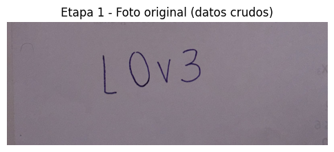

La foto de prueba es una imagen de 1600x616 píxeles tomada con el celular. Contiene la
secuencia **L0V3** escrita con bolígrafo sobre papel. Se eligió a propósito una
mezcla de letras y dígitos: sirve para ver cómo se comporta un modelo que solo conoce
dígitos y para justificar la bonificación de EMNIST.

### Etapa 2.1. Escala de grises y suavizado

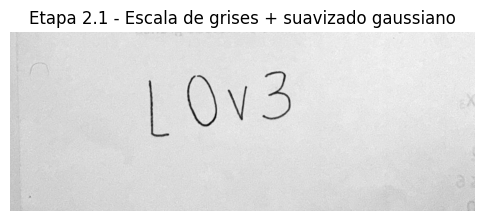

La imagen se reescala a una altura fija de 1000 píxeles (tamaño de trabajo 1000x2597)
para que todos los parámetros siguientes sean independientes de la resolución de la
cámara. Luego se convierte a escala de grises y se aplica un filtro gaussiano que
atenúa la textura del papel y el ruido del sensor sin borrar los trazos.

### Etapa 2.2. Umbralización adaptativa

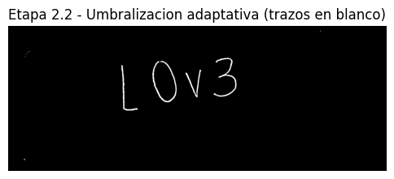

La umbralización adaptativa (`blockSize = 35`, `C = 15`) calcula un umbral distinto
para cada vecindad, por lo que tolera la iluminación desigual de la foto. El resultado
es una imagen binaria con los trazos en blanco sobre fondo negro, la misma convención
de MNIST.

### Etapa 2.3. Operaciones morfológicas

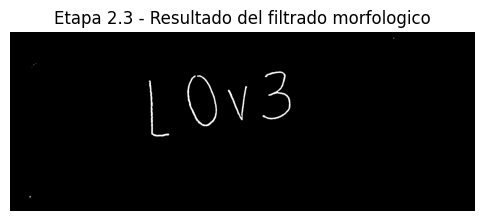

Con un kernel elíptico de 3x3, primero un cierre une los tramos del trazo que el
bolígrafo dejó entrecortados y luego una apertura elimina las motas aisladas. El kernel es pequeño a propósito
para no pegar caracteres vecinos.

### Etapa 2.4. Contornos y filtrado de ruido

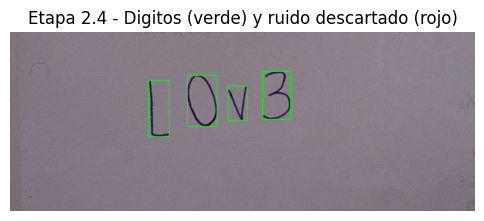

Se encontraron **4 candidatos y los 4 se seleccionaron** como caracteres (cajas
verdes). El filtrado descarta contornos con área menor a 150 píxeles, los que tocan el
borde de la imagen (sombras, dedos, bordes del papel) y los que no están alineados en
la fila principal o tienen una altura muy distinta a la del resto. En esta foto no
quedó ruido marcado en rojo. Las cajas se ordenan de izquierda a derecha para
reconstruir la secuencia.

### Etapa 3. Estandarización al formato MNIST

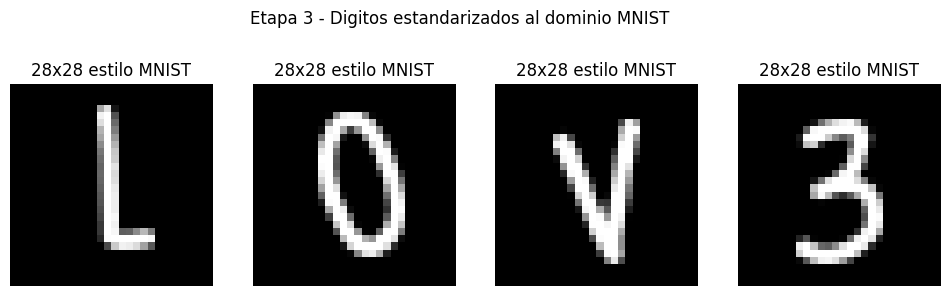

Cada carácter recortado pasa por el mismo proceso con el que se construyó MNIST:

1. Se normaliza el grosor del trazo a unos 2.5 píxeles mediante la transformada de
   distancia y una dilatación. Sin este paso, el bolígrafo fino casi desaparece al
   reducir la imagen.
2. Se escala a una caja de 20x20 conservando la relación de aspecto, para que la `L` o
   el `0` no se deformen.
3. Se centra en un lienzo de 28x28 según su centro de masa.

El resultado son cuatro tensores visualmente indistinguibles de una muestra de MNIST:
trazo blanco, fondo negro y el carácter centrado con margen.

### Etapa 4. Inferencia con LeNet-5 (solo dígitos)

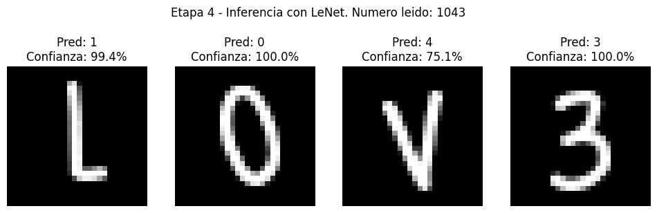

| Carácter real | Predicción | Confianza | Segunda opción |
|---------------|------------|-----------|----------------|
| L | 1 | 99.4 % | 2 (0.5 %) |
| 0 | 0 | 100.0 % | 9 |
| V | 4 | 75.1 % | 1 (24.8 %) |
| 3 | 3 | 100.0 % | — |

**Secuencia leída: `1043`.** Los dos dígitos reales (`0` y `3`) se reconocen con
confianza del 100 %, lo que confirma que la segmentación y la estandarización
reproducen bien el dominio de MNIST. Las letras no pueden leerse bien porque el modelo
solo tiene 10 clases, y por eso las asigna al dígito de forma más parecida:

- La `L` se lee como `1` con 99.4 %: su trazo vertical domina y el trazo horizontal
  corto se parece a la base que muchas personas le ponen al 1.
- La `V` se lee como `4` con solo 75.1 % y una segunda opción fuerte (`1`, 24.8 %).
  La confianza baja es la señal de que el carácter no pertenece a ninguna clase
  conocida. Esto demuestra que la confianza sirve como herramienta de diagnóstico.

La conclusión es que el error no está en el procesamiento de la imagen, sino en el
vocabulario del modelo. Esto lleva directamente a la bonificación 1.

## Retos de bonificación

Las tres bonificaciones se ejecutan de punta a punta sobre la misma foto de la
Etapa 1. Las bonificaciones 2 y 3 simulan por defecto la condición difícil para
compararla con el pipeline base; con fotos reales que ya tengan esa condición basta con
poner `SIMULAR_BAJO_CONTRASTE = False` o `SIMULAR_TRAZOS_CONECTADOS = False`.

### Bonificación 1. Clasificación alfanumérica con EMNIST

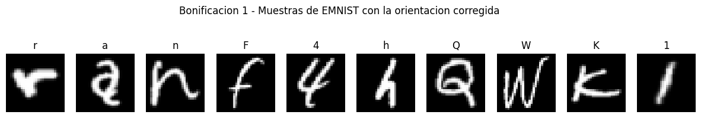

Se usó el split `balanced` de EMNIST: 112 800 imágenes de entrenamiento, 18 800 de
prueba y 47 clases (10 dígitos, 26 mayúsculas y 11 minúsculas que no se confunden con
su mayúscula). Los datos se descargan del sitio oficial de NIST (~560 MB) y se leen en
formato IDX con NumPy, porque `tfds.load("emnist")` no funciona en Colab.

Las imágenes de EMNIST vienen guardadas transpuestas respecto a MNIST, así que se
corrige la orientación antes de entrenar. La figura muestra muestras ya corregidas
(`r a n F 4 h Q W K 1`), todas en posición de lectura normal.

La misma arquitectura LeNet-5, con la capa de salida ampliada a 47 neuronas, alcanzó
**85.69 %** de exactitud en prueba tras 10 épocas. Es menor que en MNIST porque el
problema es más difícil: hay casi cinco veces más clases y varias son ambiguas incluso
para una persona (`0` y `O`, `1`, `I` y `l`, `5` y `S`, `2` y `Z`).


| Carácter real | Predicción EMNIST | Confianza |
|---------------|-------------------|-----------|
| L | L | 90.6 % |
| 0 | 0 | 62.3 % |
| V | V | 98.1 % |
| 3 | 3 | 100.0 % |

**Texto leído: `L0V3`, correcto en los cuatro caracteres.** Las letras que el modelo
de dígitos no podía leer ahora se reconocen con alta confianza. El único valor bajo es
el del `0` (62.3 %): un óvalo cerrado puede ser tanto el dígito cero como la letra O, y
el modelo reparte la probabilidad entre ambas clases. Es una ambigüedad propia de la
escritura, no un fallo del pipeline.

### Bonificación 2. Bajo contraste y fondos complejos

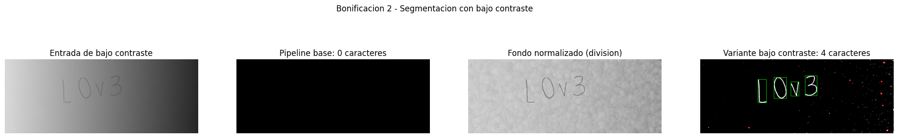

Para evaluar esta condición, la foto se degrada artificialmente: el contraste se
reduce al 12 % (la tinta queda a unos 10 niveles de gris del papel), se añade una
sombra lateral que oscurece la imagen de izquierda a derecha y ruido de sensor (primer
panel). El resultado:

- **Pipeline base: 0 caracteres** (segundo panel). La diferencia entre trazo y papel
  es tan pequeña que la umbralización adaptativa con `C = 15` no marca ningún píxel.
- **Fondo normalizado** (tercer panel): se estima la iluminación del papel con un
  cierre morfológico de gran tamaño, que borra los trazos y deja solo el fondo y las
  sombras, y se divide la imagen por esa estimación. Esto aplana el gradiente y
  recupera los trazos, aunque también realza la textura del papel.
- **Variante de bajo contraste: 4 caracteres** (cuarto panel). Sobre la imagen
  normalizada se aplica un umbral estadístico: un píxel es trazo si queda por debajo de
  la media de su entorno más de `K_SIGMA = 3` veces la desviación robusta (MAD). Como la MAD se mide en cada
  foto, el umbral se adapta solo a su nivel de ruido. Las motas de textura que
  sobreviven (en rojo) se descartan con el mismo filtrado de la Etapa 2.4.


**Texto leído: `L0V3`** con confianzas de 91.0 %, 62.6 %, 98.4 % y 99.9 %, prácticamente
iguales a las de la foto original. Es decir, la variante recupera los caracteres con
la misma calidad que en condiciones normales.

Durante el desarrollo se probaron dos alternativas que no funcionaron: CLAHE seguido de
Otsu (realzaba tanto la textura que la máscara quedaba llena de ruido) y Otsu después
de la división de fondo (el histograma no es bimodal cuando el trazo ocupa tan pocos
píxeles).

### Bonificación 3. Trazos conectados

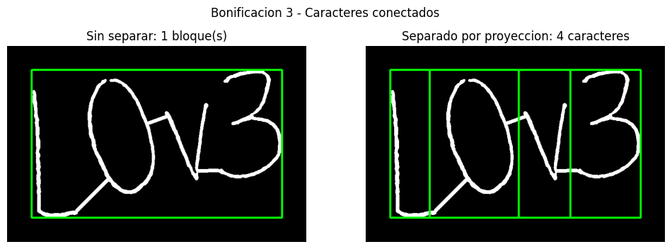

La foto se modifica uniendo cada carácter con el siguiente mediante un trazo, como
ocurre en la escritura cursiva o apresurada. Sin tratamiento, el pipeline encuentra
**1 solo bloque** que contiene toda la palabra (panel izquierdo).

La variante detecta los bloques demasiado anchos (relación ancho/alto mayor a
`RELACION_ANCHO_MAX = 1.3`) y los divide:

1. Calcula la proyección vertical (cantidad de píxeles de trazo por columna).
2. Busca los valles de esa proyección: las columnas con poca tinta, donde suele estar
   la unión entre dos caracteres.
3. Entre los valles candidatos elige el corte con el que el modelo clasifica ambos
   lados con mayor confianza.

El resultado son **4 caracteres** (panel derecho), la cantidad correcta.

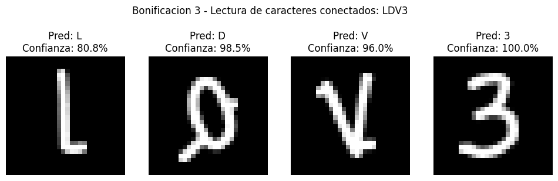

| Carácter real | Predicción | Confianza |
|---------------|------------|-----------|
| L | L | 80.8 % |
| 0 | D | 98.5 % |
| V | V | 96.0 % |
| 3 | 3 | 100.0 % |

**Texto leído: `LDV3`, 3 de 4 caracteres correctos.** El error del `0` se explica al
ver su recorte: el trazo de unión entre la `L` y el `0` sale en diagonal y entra por
debajo del óvalo. Como un corte vertical no puede separar una línea diagonal, ese
fragmento queda pegado al `0` como una cola, y el modelo lo interpreta como una `D`.
La `V` también conserva parte de la unión con el `0`, lo que baja su confianza del
98.1 % al 96.0 %, aunque se sigue leyendo bien.

Esta es la limitación principal del método de proyección: funciona bien cuando la
unión entre caracteres es aproximadamente horizontal, pero no cuando la unión cruza en
diagonal la zona de otro carácter. Una mejora futura sería eliminar el trazo de unión
antes de clasificar (por ejemplo, con esqueletización y poda de ramas) o usar un modelo
de secuencias que lea la palabra completa sin segmentarla.

## Conclusiones

- **La coincidencia de dominio manda.** El 98.96 % sobre MNIST solo se traslada a la
  foto real porque la Etapa 3 reproduce fielmente el formato de MNIST: los dígitos
  reales de la foto se leyeron con 100 % de confianza.
- **El vocabulario del modelo limita lo que puede leer.** Con 10 clases, las letras se
  convierten en el dígito más parecido (`L0V3` → `1043`); con las 47 clases de EMNIST
  la lectura es correcta, a cambio de una exactitud general menor (85.69 %).
- **OpenCV y la red neuronal se complementan.** El procesamiento clásico encuentra y
  aísla los caracteres; la red reconoce su forma. Cuando falla la segmentación, como
  con bajo contraste o trazos conectados, la red no puede compensarlo.
- **La confianza es una buena herramienta de diagnóstico.** Los valores bajos
  señalaron los casos problemáticos: la `V` leída como `4` (75.1 %) y la ambigüedad
  entre `0` y `O` (62.3 %).
- **La normalización estadística resuelve el bajo contraste.** Dividir por el fondo y
  umbralizar con la MAD recuperó los 4 caracteres donde el pipeline base no encontró
  ninguno.
- **Separar trazos conectados es el reto más difícil.** La proyección vertical con
  cortes guiados por el modelo encontró los 4 caracteres, pero las uniones diagonales
  dejan restos que alteran la forma de las letras.

### Desafíos encontrados

1. **Ruido leído como caracteres:** la sombra de un dedo generó contornos falsos. Se
   resolvió descartando lo que toca el borde y conservando solo la fila de contornos
   alineados y de altura similar.
2. **Trazos finos:** al reducir la foto a 20x20 el bolígrafo fino casi desaparecía. Se
   resolvió normalizando el grosor con transformada de distancia y dilatación.
3. **Dependencia de la resolución:** se resolvió trabajando siempre a una altura fija.
4. **Descarga de EMNIST:** el servidor de NIST rechazaba la descarga hecha desde
   Python (error 403). Se resolvió enviando un encabezado `User-Agent` de navegador.
5. **Orientación de EMNIST:** las imágenes vienen transpuestas; sin corregirlas el
   modelo aprende caracteres girados y falla con las fotos reales.

## Cómo ejecutar en Google Colab

1. Sube `pipeline_mnist_lenet.ipynb` a [Google Colab](https://colab.research.google.com/).
2. Activa la GPU en `Entorno de ejecución > Cambiar tipo de entorno de ejecución > GPU`.
3. Ejecuta las celdas en orden, de arriba hacia abajo:
   - **Etapa 0:** entrena LeNet-5 y guarda el modelo en `lenet_mnist_aug.keras`. Si el
     archivo ya existe, se carga en lugar de reentrenar.
   - **Etapa 1:** aparece un selector de archivos para elegir la foto. Para usar la
     cámara, cambia `USAR_CAMARA = True`.
   - **Etapas 2 a 4:** segmentan, estandarizan y clasifican los caracteres.
   - **Bonificaciones:** descargan EMNIST, entrenan el modelo alfanumérico
     (`lenet_emnist_balanced.keras`) y ejecutan las variantes de bajo contraste y
     trazos conectados.

## Requisitos

En Colab todas las dependencias vienen preinstaladas. Para ejecución local:

```
pip install opencv-python-headless tensorflow numpy matplotlib scipy
```

En local, la selección de la imagen usa un explorador de archivos (tkinter); si no está
disponible, el notebook pide la ruta por teclado.

## Arquitectura del modelo

LeNet-5: tres capas convolucionales (6, 16 y 120 filtros, kernels de 5x5) intercaladas
con submuestreo promedio, seguidas de dos capas densas (84 y 10 neuronas). La entrada es
de 32x32x1 (MNIST de 28x28 con un borde de 2 píxeles). Para EMNIST se usa la misma
arquitectura con 47 neuronas de salida.

Durante el entrenamiento se aplican rotaciones (±15°), traslaciones (±10 %), zoom
(±15 %) y engrosamiento aleatorio del trazo, para que el modelo tolere las variaciones
de la escritura real.

## Parámetros principales

| Parámetro | Valor | Propósito |
|-----------|-------|-----------|
| `ALTO_TRABAJO` | 1000 px | Independiza los parámetros de la resolución de la cámara. |
| `blockSize`, `C` | 35, 15 | Umbralización adaptativa robusta a sombras y textura del papel. |
| Kernel morfológico | Elipse 3x3 | Une trazos entrecortados sin pegar caracteres vecinos. |
| `AREA_MINIMA` | 150 px | Descarta motas pequeñas. |
| `MARGEN_BORDE` | 2 % | Descarta sombras, dedos y bordes del papel. |
| `N_DIGITOS` | `None` | Opcional: limita la lectura a una cantidad conocida de caracteres. |
| `GROSOR_OBJETIVO` | 2.5 px | Grosor del trazo en la caja de 20x20, como en MNIST. |
| `UMBRAL_CONFIANZA` | 0.6 | Por debajo de este valor el carácter se marca como dudoso (`?`). |
| `SIMULAR_BAJO_CONTRASTE` | `True` | Bonificación 2: degrada la foto (contraste al 12 %) para la comparación. |
| `K_SIGMA` | 3.0 | Bonificación 2: desviaciones robustas (MAD) para considerar un píxel como trazo. |
| `SIMULAR_TRAZOS_CONECTADOS` | `True` | Bonificación 3: une los caracteres con trazos para la comparación. |
| `RELACION_ANCHO_MAX` | 1.3 | Bonificación 3: ancho/alto a partir del cual un bloque se intenta separar. |

## Consejos de captura

- Iluminación uniforme, sin sombras marcadas sobre los caracteres.
- Trazos claros y continuos.
- Separación visible entre caracteres, escritos en una sola fila.
- Formatos JPG o PNG.
